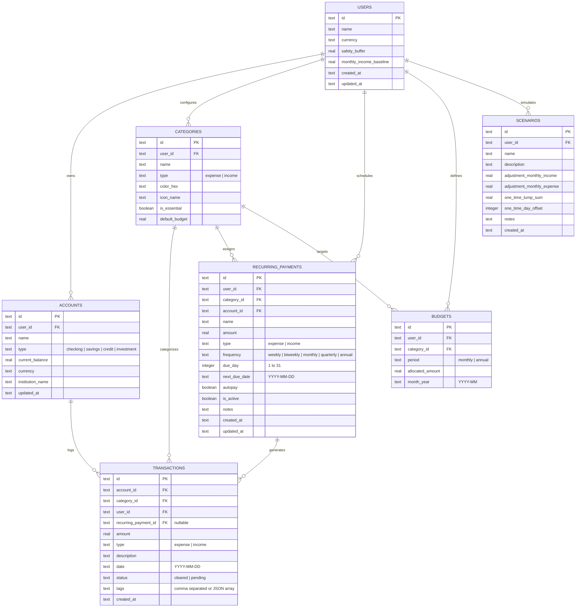

# Entity Relationship Diagram & Data Schema (ERD)

**Project**: ApexFin — Financial Spendings & Cashflow Prediction Engine  
**Version**: 1.0.0  
**Storage Engine**: SQLite 3 (WAL Mode) / Typed In-Memory & Local JSON-Store Persistence  

---

## 1. Visual Entity Relationship Diagram (Mermaid)



---

## 2. Concrete SQL DDL Specification

```sql
-- Enforce foreign key constraints and WAL logging
PRAGMA foreign_keys = ON;
PRAGMA journal_mode = WAL;

-- Users Table
CREATE TABLE IF NOT EXISTS users (
    id TEXT PRIMARY KEY NOT NULL,
    name TEXT NOT NULL,
    currency TEXT NOT NULL DEFAULT 'USD',
    safety_buffer REAL NOT NULL DEFAULT 1500.00,
    monthly_income_baseline REAL NOT NULL DEFAULT 6500.00,
    created_at DATETIME NOT NULL DEFAULT CURRENT_TIMESTAMP,
    updated_at DATETIME NOT NULL DEFAULT CURRENT_TIMESTAMP
);

-- Accounts Table (Checking, Savings, Credit Cards)
CREATE TABLE IF NOT EXISTS accounts (
    id TEXT PRIMARY KEY NOT NULL,
    user_id TEXT NOT NULL REFERENCES users(id) ON DELETE CASCADE,
    name TEXT NOT NULL,
    type TEXT NOT NULL CHECK(type IN ('checking', 'savings', 'credit', 'investment')),
    current_balance REAL NOT NULL DEFAULT 0.00,
    currency TEXT NOT NULL DEFAULT 'USD',
    institution_name TEXT NOT NULL,
    updated_at DATETIME NOT NULL DEFAULT CURRENT_TIMESTAMP
);

CREATE INDEX IF NOT EXISTS idx_accounts_user_id ON accounts(user_id);

-- Categories Table
CREATE TABLE IF NOT EXISTS categories (
    id TEXT PRIMARY KEY NOT NULL,
    user_id TEXT NOT NULL REFERENCES users(id) ON DELETE CASCADE,
    name TEXT NOT NULL,
    type TEXT NOT NULL CHECK(type IN ('expense', 'income')),
    color_hex TEXT NOT NULL DEFAULT '#6366f1',
    icon_name TEXT NOT NULL DEFAULT 'Tag',
    is_essential BOOLEAN NOT NULL DEFAULT 1,
    default_budget REAL NOT NULL DEFAULT 0.00
);

CREATE INDEX IF NOT EXISTS idx_categories_user_type ON categories(user_id, type);

-- Recurring Payments & Monthly Commitments Table
CREATE TABLE IF NOT EXISTS recurring_payments (
    id TEXT PRIMARY KEY NOT NULL,
    user_id TEXT NOT NULL REFERENCES users(id) ON DELETE CASCADE,
    category_id TEXT NOT NULL REFERENCES categories(id) ON DELETE RESTRICT,
    account_id TEXT REFERENCES accounts(id) ON DELETE SET NULL,
    name TEXT NOT NULL,
    amount REAL NOT NULL,
    type TEXT NOT NULL CHECK(type IN ('expense', 'income')),
    frequency TEXT NOT NULL CHECK(frequency IN ('weekly', 'biweekly', 'monthly', 'quarterly', 'annual')),
    due_day INTEGER NOT NULL CHECK(due_day BETWEEN 1 AND 31),
    next_due_date TEXT NOT NULL, -- Format: YYYY-MM-DD
    autopay BOOLEAN NOT NULL DEFAULT 1,
    is_active BOOLEAN NOT NULL DEFAULT 1,
    notes TEXT,
    created_at DATETIME NOT NULL DEFAULT CURRENT_TIMESTAMP,
    updated_at DATETIME NOT NULL DEFAULT CURRENT_TIMESTAMP
);

CREATE INDEX IF NOT EXISTS idx_recurring_due_date ON recurring_payments(next_due_date);
CREATE INDEX IF NOT EXISTS idx_recurring_user_active ON recurring_payments(user_id, is_active);

-- Historical and Cleared Transactions Table
CREATE TABLE IF NOT EXISTS transactions (
    id TEXT PRIMARY KEY NOT NULL,
    account_id TEXT NOT NULL REFERENCES accounts(id) ON DELETE CASCADE,
    category_id TEXT NOT NULL REFERENCES categories(id) ON DELETE RESTRICT,
    user_id TEXT NOT NULL REFERENCES users(id) ON DELETE CASCADE,
    recurring_payment_id TEXT REFERENCES recurring_payments(id) ON DELETE SET NULL,
    amount REAL NOT NULL,
    type TEXT NOT NULL CHECK(type IN ('expense', 'income')),
    description TEXT NOT NULL,
    date TEXT NOT NULL, -- Format: YYYY-MM-DD
    status TEXT NOT NULL CHECK(status IN ('cleared', 'pending')),
    tags TEXT DEFAULT '[]', -- JSON string array
    created_at DATETIME NOT NULL DEFAULT CURRENT_TIMESTAMP
);

CREATE INDEX IF NOT EXISTS idx_transactions_date ON transactions(date DESC);
CREATE INDEX IF NOT EXISTS idx_transactions_user_cat ON transactions(user_id, category_id);

-- Monthly Budgets Table
CREATE TABLE IF NOT EXISTS budgets (
    id TEXT PRIMARY KEY NOT NULL,
    user_id TEXT NOT NULL REFERENCES users(id) ON DELETE CASCADE,
    category_id TEXT NOT NULL REFERENCES categories(id) ON DELETE CASCADE,
    period TEXT NOT NULL DEFAULT 'monthly',
    allocated_amount REAL NOT NULL,
    month_year TEXT NOT NULL, -- Format: YYYY-MM
    UNIQUE(user_id, category_id, month_year)
);

CREATE INDEX IF NOT EXISTS idx_budgets_lookup ON budgets(user_id, month_year);

-- What-If Financial Scenarios
CREATE TABLE IF NOT EXISTS scenarios (
    id TEXT PRIMARY KEY NOT NULL,
    user_id TEXT NOT NULL REFERENCES users(id) ON DELETE CASCADE,
    name TEXT NOT NULL,
    description TEXT,
    adjustment_monthly_income REAL NOT NULL DEFAULT 0.00,
    adjustment_monthly_expense REAL NOT NULL DEFAULT 0.00,
    one_time_lump_sum REAL NOT NULL DEFAULT 0.00,
    one_time_day_offset INTEGER NOT NULL DEFAULT 0,
    notes TEXT,
    created_at DATETIME NOT NULL DEFAULT CURRENT_TIMESTAMP
);
```
